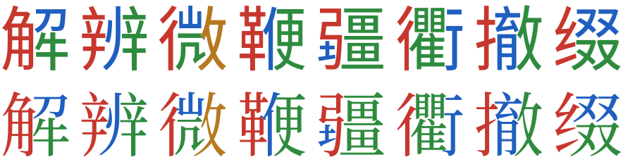

# paoding

把字体里的汉字切成部件。

<picture>
  <source media="(prefers-color-scheme: dark)" srcset="docs/images/parts-dark.svg">
  
</picture>

上：思源黑体。下：思源宋体。轮廓是字体原有的，颜色按 paoding 切出的部件填充。

paoding 为字体中的每个汉字写出一份标注：字形的哪一块属于哪个部件。标注只引用字体自己的轮廓，可用于部件着色、检索、逐部件展示。

按部件着色的字体可以直接下载：[paoding-color-fonts](https://github.com/firede/paoding-color-fonts)。

覆盖 10807 字（Make Me a Hanzi 收录的字，加上《通用规范汉字表》）。思源黑体 99% 自动通过，思源宋体 98%。也支持位图字体。

## 开始

```sh
uv sync
uv run paoding fetch
uv run paoding run --font data/fonts/SourceHanSansSC-Regular.otf --out out/sans --jobs 8
uv run paoding review out/sans --font data/fonts/SourceHanSansSC-Regular.otf
```

## 文档

- [使用](docs/usage.md)
- [原理](docs/how-it-works.md)
- [标注格式](docs/format.md)

## 许可

代码采用 MIT 许可。输入数据和生成的标注另有许可，见[数据来源与许可](docs/sources.md)。
